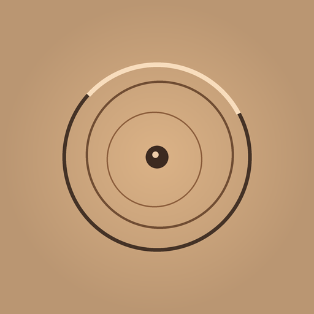

<div align="center">
  <a href="https://mebius.cc/meditation/">
    
  </a>

  <h1>silence.</h1>

  <p><em>Un moment à soi.</em></p>

  <p>Une application de méditation minimaliste, pensée pour se faire oublier.</p>

  <p>
    <a href="https://mebius.cc/meditation/"><strong>Ouvrir silence.</strong></a>
    &nbsp;·&nbsp;
    <a href="https://github.com/fanthomas/silence/releases">Versions</a>
    &nbsp;·&nbsp;
    <a href="CHANGELOG.md">Changelog</a>
  </p>

  <p>
    <a href="https://github.com/fanthomas/silence/releases/latest"></a>
    <a href="LICENSE"></a>
    <a href="https://github.com/fanthomas/silence/actions/workflows/ovh.yml"></a>
  </p>
</div>

## Moins de temps à compter. Plus de place pour méditer.

Ferme les yeux. À dix minutes, un son discret t'indique que ton minimum est atteint. Tu peux continuer, sans regarder l'heure.

**silence.** ne guide ni la respiration ni l'attention : elle accompagne la séance sans la diriger.

### Le juste nécessaire

- **Libre** : repère sonore à 10 minutes, puis séance sans limite. Un second repère à 15 minutes est facultatif.
- **Durées fixes** : 10, 12, 15 ou 20 minutes.
- **Deux tintements** : *Bol feutré* et *Bois doux*, avec volume ajustable.
- **Un cercle vivant** : animation lente, sans imposer de rythme respiratoire.
- **Revenir doucement** : deux minutes de retour silencieux.
- **Sans distraction** : temps masqué, commandes simples, réglages discrets.

### Partout, même hors connexion

silence. est une **Progressive Web App (PWA)**. Elle fonctionne dans le navigateur, peut être ajoutée à l'écran d'accueil et conserve les fichiers nécessaires à une utilisation hors connexion.

> Les navigateurs mobiles peuvent suspendre le son lorsque l'écran est verrouillé. L'application propose une option pour garder l'écran actif lorsque le navigateur le permet.

<div align="center">
  <a href="https://mebius.cc/meditation/"><strong>Essayer silence. dans le navigateur</strong></a>
</div>

## Développement

Du HTML, du CSS et du JavaScript natifs, sans framework ni compte utilisateur.

```text
meditation/
  index.html
  styles.css
  app.js
  sw.js
  manifest.webmanifest
  icons/
tests/
.github/workflows/
```

Pour l'exécuter localement :

```bash
git clone https://github.com/fanthomas/silence.git
cd silence
python -m http.server 8000
```

Puis ouvre [localhost:8000/meditation/](http://localhost:8000/meditation/).

Les tests navigateur utilisent Playwright. Voir [tests/README.md](tests/README.md).

## Versions et contributions

Les [releases GitHub](https://github.com/fanthomas/silence/releases) correspondent aux versions officielles de l'application. Chaque version comporte ses notes et une archive de l'application. Les évolutions sont consignées dans le [changelog](CHANGELOG.md).

Les améliorations sont bienvenues via [Issues](https://github.com/fanthomas/silence/issues) et [Pull requests](https://github.com/fanthomas/silence/pulls). Les contributions doivent respecter la philosophie du projet : **calme, simplicité, discrétion**.

Le déploiement de la version web est automatisé depuis `main`, **après validation des tests**, vers un répertoire SFTP OVH dédié.

## Licence

Code source publié sous [GNU Affero General Public License v3.0 uniquement](LICENSE) (`AGPL-3.0-only`).

Le nom et l'identité **silence.** ne sont pas présentés comme des éléments librement réutilisables par cette licence logicielle.
